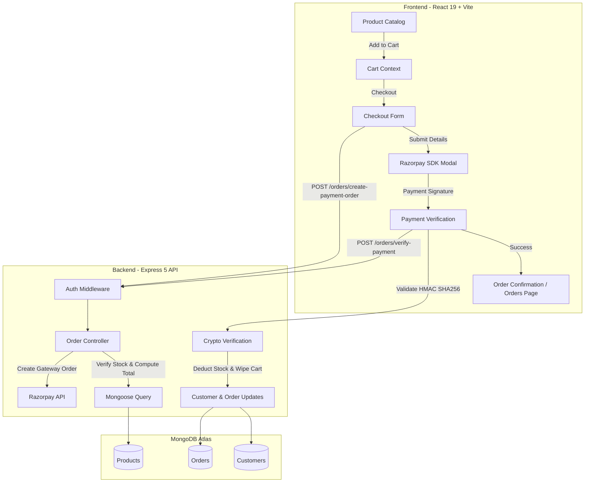

# ShopKart — Enterprise E-Commerce Platform

[](https://nodejs.org/)
[](https://react.dev/)
[](https://expressjs.com/)
[](https://www.mongodb.com/)
[](https://tailwindcss.com/)
[](https://vitejs.dev/)
[](https://razorpay.com/)

ShopKart is a modern, full-stack, enterprise-grade e-commerce application engineered with the MERN stack (MongoDB, Express, React, Node.js). Built with production design standards, an Apple-inspired glassmorphic design system, robust JWT cookie authentication, real-time cart state synchronization, resilient inventory management, and end-to-end Razorpay payment gateway integration with cryptographic HMAC verification.

---

## Table of Contents

- [Architectural Overview](#architectural-overview)
- [Key Features](#key-features)
- [System Architecture](#system-architecture)
- [Technology Stack](#technology-stack)
- [Repository Structure](#repository-structure)
- [Database Schema & Entity Models](#database-schema--entity-models)
- [REST API Specifications](#rest-api-specifications)
- [Installation & Setup](#installation--setup)
- [Environment Configuration](#environment-configuration)
- [Payment Gateway Integration](#payment-gateway-integration)
- [Security & Engineering Practices](#security--engineering-practices)
- [License](#license)

---

## Architectural Overview

ShopKart delivers an editorial e-commerce customer experience backed by deterministic, server-enforced business logic:

1. **Client Tier**: React 19 single-page application built on Vite, styled with Tailwind CSS v4 and vanilla CSS design tokens. Employs contextual global state providers (`AuthContext`, `CartContext`), client-side input validations, and dynamic script injection for secure payment checkouts.
2. **Server Tier**: Express 5 application structured with clean separation of concerns across controllers, middleware, routes, and utility modules. Enforces authentication via HTTP-only same-site cookies and Bearer tokens.
3. **Data Tier**: MongoDB Atlas multi-tenant database managed via Mongoose 9 schemas with referential integrity, optimistic inventory checks, and historical purchase snapshots.
4. **Payment Gateway**: Server-side Razorpay order generation coupled with mandatory client-callback HMAC SHA256 cryptographic signature validation.

---

## Key Features

### 🛍️ Product Catalog & Discovery
- **Extensive Seed Catalog**: 50+ curated products distributed across Electronics, Fashion, Home & Living, Books, Wellness, and Workspace categories.
- **Search & Filter Pipeline**: Server-driven query pipeline supporting multi-field keyword regex search, category filtering, and bidirectional price sorting.
- **Micro-Interactions**: Hover image scaling, skeleton loaders, and contextual stock status badges.

### 💖 Wishlist Management
- **User-Specific Persistence**: Direct 1-to-N Mongoose relationship between customer documents and product ObjectIds.
- **Atomic Mutation**: Dedicated toggle endpoint supporting idempotent additions and removals.
- **Quick-Migration**: One-click "Add to Bag" action transferring saved items into active cart state.

### 🛒 Real-Time Cart Architecture
- **In-Memory & Database Sync**: Subdocument array embedded within customer records preserving cart state across sessions and devices.
- **Inventory Boundary Enforcement**: Add and increment operations cross-reference available warehouse stock.
- **Derived Values**: Real-time evaluation of total unit count, order subtotal, and dynamic free-shipping threshold qualification.

### 💳 Checkout & Order Processing
- **Server-Side Total Re-calculation**: Server independently evaluates every item price against current database documents to prevent client-side price tampering.
- **Purchase-Time Snapshots**: Product titles, unit prices, quantities, and thumbnail URLs are copied directly into the order record, ensuring historical accounting integrity.
- **Cryptographic Payment Verification**: Payment confirmation is gated behind server-side HMAC SHA256 signature matching using the private Razorpay secret.
- **Atomic Cart Clearing**: Cart records in MongoDB and global state are only purged once payment verification succeeds.
- **Order Lifecycle Tracking**: Progression pipeline supporting statuses: `PENDING_PAYMENT` → `PLACED` → `CONFIRMED` → `SHIPPED` → `DELIVERED`.

---

## System Architecture



---

## Technology Stack

| Layer | Technology | Purpose |
|---|---|---|
| **Frontend Framework** | React 19 | UI rendering and modular component composition |
| **Build Tooling** | Vite 8 | Fast HMR dev server and optimized production bundling |
| **Routing** | React Router v7 | Declarative client-side routing with guarded boundaries |
| **Styling** | Tailwind CSS v4 | Utility-first design system with glassmorphic tokens |
| **HTTP Client** | Axios | Request/response interceptors with credential inclusion |
| **Backend Runtime** | Node.js (v20+) | Asynchronous server execution environment |
| **Web Framework** | Express 5 | RESTful routing, middleware pipeline, and JSON parsing |
| **Database** | MongoDB Atlas | Distributed document-oriented cloud database |
| **ODM** | Mongoose 9 | Object data modeling, validation, and schema definitions |
| **Authentication** | JSON Web Tokens & bcrypt | Stateless JWT issuing and salted password hashing |
| **Payment Gateway** | Razorpay Node SDK | Gateway order dispatch and test transaction lifecycle |

---

## Repository Structure

```text
ShopKart/
├── backend/
│   ├── config/
│   │   └── razorpay.js              # Razorpay SDK configuration
│   ├── controllers/
│   │   ├── cart.controller.js       # Cart business operations & validations
│   │   ├── customerController.js    # Auth: registration, login, profile, logout
│   │   ├── order.controller.js      # Order lifecycle, Razorpay orders, HMAC verification
│   │   ├── product.controller.js    # Product queries, sorting, search, filtering
│   │   └── wishlist.controller.js   # Wishlist persistence & toggle logic
│   ├── middlewares/
│   │   └── authMiddleware.js        # Dual-strategy JWT authentication (cookie/bearer)
│   ├── models/
│   │   ├── customerModel.js         # Customer schema with embedded cart & wishlist
│   │   ├── order.model.js           # Order schema with purchase-time snapshots
│   │   ├── product.model.js         # Product schema with validations
│   │   └── user.model.js            # User model alias
│   ├── routes/
│   │   ├── cart.routes.js           # /cart endpoints (Protected)
│   │   ├── customerRoutes.js        # /customers auth endpoints
│   │   ├── order.routes.js          # /orders endpoints (Protected)
│   │   ├── product.routes.js        # /products public catalog endpoints
│   │   └── wishlist.routes.js       # /wishlist endpoints (Protected)
│   ├── utils/
│   │   └── generateToken.js         # 7-day signed JWT generator
│   ├── .env                         # Backend environment variables
│   ├── index.js                     # Server entrypoint and route mounting
│   ├── package.json                 # Backend dependencies & npm scripts
│   └── seed.js                      # 52-product catalog seeding utility
│
├── frontend/
│   ├── src/
│   │   ├── axiosCalls/
│   │   │   └── axios.js             # Configured Axios instance with credentials
│   │   ├── components/
│   │   │   ├── AuthModal.jsx        # Glassmorphic login/signup modal
│   │   │   ├── CartItem.jsx         # Cart row component with quantity steppers
│   │   │   ├── Navbar.jsx           # Responsive header with live cart badge
│   │   │   ├── ProductCard.jsx      # Catalog card with quick-add overlay
│   │   │   ├── ProtectedRoute.jsx   # Route guard for authenticated users
│   │   │   ├── PublicRoute.jsx      # Route guard for guest sessions
│   │   │   ├── SearchBar.jsx        # Filter bar with category pills & sort controls
│   │   │   └── WishlistCard.jsx     # Wishlist product card with move-to-bag
│   │   ├── context/
│   │   │   ├── AuthContext.jsx      # Authentication session provider
│   │   │   └── CartContext.jsx      # Global cart state & derived calculations
│   │   ├── pages/
│   │   │   ├── Cart.jsx             # Shopping bag review with order calculations
│   │   │   ├── Checkout.jsx         # Shipping details form & Razorpay integration
│   │   │   ├── Home.jsx             # Member dashboard
│   │   │   ├── Landing.jsx          # Editorial landing page with hero & trust pillars
│   │   │   ├── Login.jsx            # Standalone authentication view
│   │   │   ├── OrderSuccess.jsx     # Post-payment order receipt
│   │   │   ├── Orders.jsx           # Order history & status progression
│   │   │   ├── ProductDetails.jsx   # Individual product view with gallery & specs
│   │   │   ├── Products.jsx         # Full catalog discovery page
│   │   │   ├── Profile.jsx          # User profile & session metrics
│   │   │   ├── SignUp.jsx           # Standalone registration view
│   │   │   └── Wishlist.jsx         # Saved items overview
│   │   ├── services/
│   │   │   └── api.js               # Client API methods for all backend endpoints
│   │   ├── App.jsx                  # Route definitions & provider tree
│   │   ├── index.css                # Tailwind imports, design tokens, glass styles
│   │   └── main.jsx                 # Client entry point
│   ├── index.html                   # HTML template with Google Fonts (Inter + Playfair)
│   ├── package.json                 # Frontend dependencies & npm scripts
│   └── vite.config.js               # Vite configuration with Tailwind plugin
│
├── .gitignore
└── README.md
```

---

## Database Schema & Entity Models

### 1. Customer (`Customer`)
```typescript
{
  name: String (required, trim),
  email: String (required, unique),
  password: String (hashed via bcrypt),
  phoneNo: String (required),
  wishlist: [ObjectId -> Product],
  cart: [
    {
      product: ObjectId -> Product (required),
      quantity: Number (default: 1, min: 1)
    }
  ],
  createdAt: Date (default: Date.now)
}
```

### 2. Product (`Product`)
```typescript
{
  name: String (required, trim),
  description: String (required, trim),
  price: Number (required, min: 0.01),
  category: String (required, trim),
  image: String (required, trim),
  stock: Number (required, min: 0),
  createdAt: Date (default: Date.now)
}
```

### 3. Order (`Order`)
```typescript
{
  user: ObjectId -> Customer (required),
  items: [
    {
      product: ObjectId -> Product (required),
      name: String (required),
      price: Number (required),
      quantity: Number (required, min: 1),
      image: String
    }
  ],
  shippingAddress: {
    fullName: String (required),
    phone: String (required),
    addressLine1: String (required),
    city: String (required),
    state: String (required),
    pincode: String (required)
  },
  totalAmount: Number (required),
  paymentStatus: "PENDING" | "PAID" | "FAILED",
  status: "PENDING_PAYMENT" | "PLACED" | "CONFIRMED" | "SHIPPED" | "DELIVERED",
  razorpayOrderId: String,
  razorpayPaymentId: String,
  createdAt: Date,
  updatedAt: Date
}
```

---

## REST API Specifications

### Authentication (`/customers`)
| Method | Endpoint | Access | Description |
|---|---|---|---|
| `POST` | `/customers/register` | Public | Register new customer, hashes password, issues JWT cookie |
| `POST` | `/customers/login` | Public | Authenticates credentials, sets 7-day HTTP-only cookie |
| `POST` | `/customers/logout` | Public | Clears auth cookie |
| `GET` | `/customers/me` | Protected | Returns current authenticated user record |

### Products (`/products`)
| Method | Endpoint | Access | Description |
|---|---|---|---|
| `GET` | `/products` | Public | Fetch catalog with `?search=`, `?category=`, and `?sort=` |
| `GET` | `/products/:id` | Public | Retrieve single product by MongoDB ObjectId |
| `POST` | `/products` | Admin/Public | Create new product document |

### Wishlist (`/wishlist`)
| Method | Endpoint | Access | Description |
|---|---|---|---|
| `GET` | `/wishlist` | Protected | Fetch current user's populated wishlist |
| `POST` | `/wishlist/:productId` | Protected | Add product to wishlist (duplicate prevention) |
| `DELETE`| `/wishlist/:productId` | Protected | Remove item from wishlist |
| `PATCH` | `/wishlist/:productId/toggle` | Protected | Toggle product presence in user wishlist |

### Cart (`/cart`)
| Method | Endpoint | Access | Description |
|---|---|---|---|
| `GET` | `/cart` | Protected | Fetch user's populated cart with product references |
| `POST` | `/cart/:productId` | Protected | Add item or increment existing row with stock check |
| `PATCH` | `/cart/:productId` | Protected | Update item quantity with warehouse stock limits |
| `DELETE`| `/cart/:productId` | Protected | Remove product row from cart |

### Orders & Checkout (`/orders`)
| Method | Endpoint | Access | Description |
|---|---|---|---|
| `POST` | `/orders/create-payment-order` | Protected | Validates cart, stock, creates pending order & Razorpay order |
| `POST` | `/orders/verify-payment` | Protected | Verifies HMAC SHA256 signature, marks order PAID, clears cart |
| `GET` | `/orders` | Protected | Retrieve all orders placed by the authenticated customer |
| `GET` | `/orders/:id` | Protected | Retrieve individual order with ownership validation |
| `PATCH` | `/orders/:id/status` | Protected | Developer simulator to advance order fulfillment status |

---

## Installation & Setup

### Prerequisites
- [Node.js](https://nodejs.org/) (v18.0.0 or higher)
- [npm](https://www.npmjs.com/) (v9.0.0 or higher)
- Active [MongoDB Atlas](https://www.mongodb.com/cloud/atlas) cluster connection string
- [Razorpay](https://dashboard.razorpay.com/) account (Test Mode credentials)

### 1. Clone Repository
```bash
git clone https://github.com/your-username/ShopKart.git
cd ShopKart
```

### 2. Backend Installation & Database Seeding
```bash
cd backend
npm install

# Seed the 52-product catalog to MongoDB
npm run seed

# Start backend development server
npm run dev
# Server initializes at http://localhost:8001
```

### 3. Frontend Installation & Build
```bash
cd ../frontend
npm install

# Run Vite development server
npm run dev
# Application accessible at http://localhost:5173

# Or build for production
npm run build
```

---

## Environment Configuration

Create a `.env` file in the `backend/` directory:

```env
# Database Configuration
dbUrl=mongodb+srv://<username>:<password>@cluster0.mongodb.net/?appName=Cluster0

# Authentication
JWT_SECRET=your_jwt_private_secret_key_here

# Network Port
port=8001

# Razorpay Test Mode Credentials
RAZORPAY_KEY_ID=rzp_test_xxxxxxxxxxxxxx
RAZORPAY_KEY_SECRET=your_razorpay_secret_key_here
```

> **Security Note:** `RAZORPAY_KEY_SECRET` must **never** be exposed in client code or pushed to public version control. It is utilized exclusively on the server for cryptographic signature validation.

---

## Payment Gateway Integration

The checkout pipeline enforces an end-to-end security cycle:

```text
React Client                                         Express Backend                            Razorpay Gateway
     |                                                      |                                          |
     |--- 1. POST /orders/create-payment-order ------------>|                                          |
     |       (Includes Shipping Address)                    |--- 2. Load Cart & Stock                  |
     |                                                      |--- 3. Calculate Server-Side Total        |
     |                                                      |--- 4. Create PENDING_PAYMENT Order       |
     |                                                      |--- 5. Create Razorpay Order (Paise) ---->|
     |                                                      |<-- 6. Returns razorpay_order_id ---------|
     |<-- 7. Response { shopKartOrderId, razorpayOrderId } -|                                          |
     |                                                                                                 |
     |--- 8. Open Razorpay Checkout Modal (Key ID) --------------------------------------------------->|
     |<-- 9. User completes payment, receives { payment_id, order_id, signature } ---------------------|
     |                                                                                                 |
     |--- 10. POST /orders/verify-payment ----------------->|                                          |
     |        (Payload: IDs + Signature)                    |--- 11. crypto.createHmac('sha256', Secret)
     |                                                      |--- 12. Match Expected === Received?      |
     |                                                      |        [YES]                             |
     |                                                      |--- 13. Order -> PAID / PLACED            |
     |                                                      |--- 14. Stock Decremented                 |
     |                                                      |--- 15. User Cart Emptied in DB           |
     |<-- 16. Returns Confirmed Order ----------------------|                                          |
     |                                                                                                 |
     |--- 17. clearCart() in React Context                                                             |
     |--- 18. Redirect to /order-success/:id                                                           |
```

---

## Security & Engineering Practices

- **Zero-Trust Pricing**: Client-side prices and totals are completely discarded. The server computes the payable amount from current database records.
- **Atomic Operations**: Product stock decrementing and cart purging execute concurrently only upon confirmed payment authentication.
- **HTTP-Only Cookies**: JWTs are transferred via HTTP-only, `sameSite: "lax"` cookies, protecting credentials from Cross-Site Scripting (XSS) attacks.
- **Access Ownership**: Orders and cart items are scoped strictly to the authenticated `req.user._id`, preventing Insecure Direct Object References (IDOR).
- **Graceful Failure Preservation**: If a user cancels payment or their transaction fails at the gateway, their cart items are retained without data loss.

---

## License

This project is licensed under the [ISC License](LICENSE).
